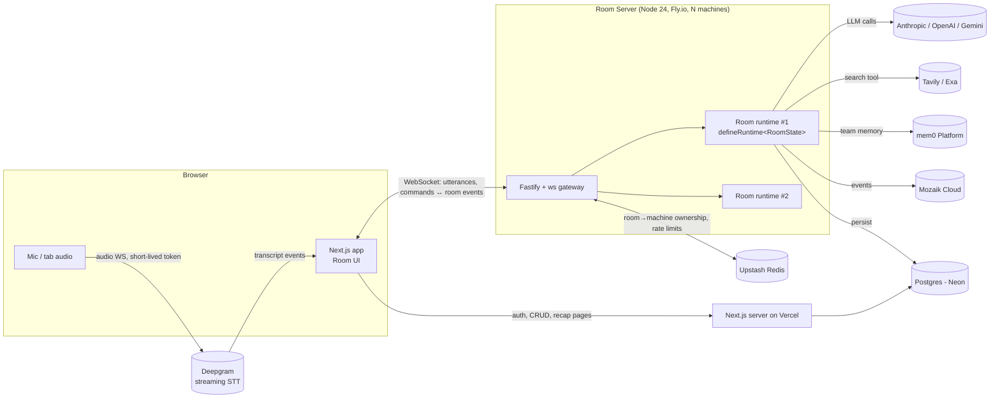

# ARCHITECTURE.md — Quorum

## 1. System overview



**Why two deployables:** Mozaik runtimes are long-lived, stateful, in-memory event buses. Serverless (Vercel functions) can't hold them. So:
- **apps/web** (Vercel): marketing, auth, dashboard, recap pages, REST. Stateless.
- **apps/rooms** (Fly.io): owns live rooms. One Mozaik runtime per active room.

## 2. Monorepo layout (pnpm workspaces + Turborepo)

```
apps/
  web/            Next.js 16 (App Router, Cache Components), Tailwind v4, Better Auth
  rooms/          Fastify + ws, hosts room runtimes
packages/
  engine/         (core) Mozaik adapter + RoomState + agents + specs + interception (no I/O frameworks)
  protocol/       zod schemas for every WS message & room event (shared web↔rooms)
  db/             Drizzle schema + migrations (Postgres)
  ui/             shared design-system components (if needed beyond apps/web)
  config/         eslint, tsconfig, prettier presets
```

`packages/engine` is the heart and the part judges will read. Rules:
- Only `engine/src/mozaik/` imports `@mozaik-ai/core`. Everything else talks to our own interfaces → swapping to 4.2 touches one folder.
- Domain (`RoomState`, artifacts, locks) is pure TS — unit-testable without network.
- Context building lives in `engine/src/context/` — never inline prompt assembly in agents (judges' "anemic domain model" pet peeve).

## 3. Room runtime design (Mozaik 4.1.0)

### 3.1 One runtime per room
```ts
// packages/engine/src/mozaik/room-runtime.ts
export function createRoomRuntime(roomId: string, deps: RoomDeps) {
  const rt = defineRuntime<RoomState>()          // fresh closure per room
  rt.initializeRuntime({ state: new RoomState(roomId, deps.budget) })
  for (const p of buildParticipants(rt, deps)) rt.join(p)
  return rt
}
```

### 3.2 RoomState (shared, typed)
```ts
class RoomState extends RuntimeState {
  transcript: Utterance[]            // rolling, windowed
  topics: Topic[]; summary: string
  claims: Map<ClaimId, Claim>        // Claim.ownerId = lock holder
  decisions: Decision[]; actions: ActionItem[]
  challenges: Challenge[]; recalls: Recall[]; answers: Answer[]
  locks: LockTable                   // tryAcquire(key, ownerId, ttlMs) / release
  llm: Semaphore                     // max in-flight LLM loops per room (e.g. 4)
  budget: TokenBudget                // per-room token/$ cap; Moderator enforces
  agentStatus: Map<AgentId, LoopPhase> // listening|thinking|tool|answering|paused
}
```
Coordination primitives (implemented by us on state, as Mozaik intends):
- **Lock** — `tryAcquire("claim:<hash>", agentId, ttl)`: only one agent works a claim; others see it's owned.
- **Semaphore** — caps concurrent LLM loops per room; waiting agents coalesce input (latest-wins) instead of queueing unbounded.
- **Ownership** — every artifact has `ownerId`; only owner mutates, others propose via events.
- **Handoff** — `handoff.requested` custom event (e.g. Researcher → Fact-Checker when an answer contains a claim).

### 3.3 Event flow — reaction, not orchestration
```
Browser ──utterance──▶ Gateway ──sendMessage(text, humanId)──▶ Mozaik bus
                                   │ fan-out (sync, non-blocking)
     ┌────────────┬────────────────┼───────────────┬──────────────┬─────────────┐
   Scribe   Fact-Checker     Decision Tracker   Action Owner   Researcher   Devil's Adv.
     │            │ (spec: has claim AND lock free)   │ (spec: commitment)   (spec: STATE: consensus w/o dissent)
   runLoop      runLoop                              runLoop ──function_call──▶ InterceptionHandler
     │            │                                                              (human approval / Moderator veto)
     └── model.answer / custom events ──▶ Broadcaster(WS→UI) · Auditor(JSONL) · Persister(PG) · Mozaik Cloud
```

Custom events we publish via `sendEvent`: `utterance.final`, `claim.detected`, `claim.verdict`, `decision.recorded`, `action.proposed`, `action.approved|rejected`, `challenge.raised`, `memory.recalled`, `handoff.requested`, `budget.pressure`, `agent.paused|resumed`.

### 3.4 Situation specifications (composable)
```ts
const factCheck = IsUtterance.and(ContainsCheckableClaim).and(ClaimLockFree)
const devilsAdvocate = OnAnyEvent.and(ConsensusWithoutDissent(3, 90_000))   // state-based
const actionOwner = IsUtterance.and(ContainsCommitment)
const welcome = IsEvent("participant.joined").and(IsHumanJoining)             // awareness
```
Cheap deterministic triage (regex/heuristics + `gemini-3.5-flash-lite`/`gpt-5.4-nano` classifier) runs **before** expensive loops → cost control.

### 3.5 Interception (two kinds)
1. **Human-in-the-loop** — Action Owner's `function_call` to `create_ticket` / `post_slack` is intercepted → `approval.requested` to UI → awaits human decision (with timeout = auto-reject) → transition continues, rewritten, or rerouted to `model_message`.
2. **Agent-to-agent** — Moderator's handler on every agent loop: if `budget.pressure` or the claim behind an action was refuted (`claim.verdict=false`), rewrite transition to stop/pause. This is the "agents control each other" story.

### 3.5b As built (Phase 1) — `packages/engine/src`
| Folder | Contents |
|---|---|
| `domain/` | Pure TS: `RoomStore`, `LockTable`, `Semaphore`, `WorkQueue`, `TokenBudget`, `ApprovalBroker`, `signals` (triage) |
| `agents/` | Declarative `AgentDefinition`s (select → begin → prompt → output schema → finish/fail); no runtime imports |
| `context/` | Prompt sections; transcript wrapped as untrusted data |
| `mozaik/` | The only place importing `@mozaik-ai/core`: room runtime, agent participant, interception, moderator, resilient runner, loop tracker/signals |
| `observers/` | Audit-log mapping (kaleidoskop shape) |
Loop lifecycle: intake handler → `WorkQueue` (latest/queue) → `begin` (locks) → room `Semaphore` → fresh `ModelContext` → `runLoop` → `LoopTracker` binds loopId on `message_received.started`, settles on `model.answer` → zod-validated output → `finish` mutates store + emits events. Loops always end with a message (real answer or an aborted/failed signal) — never a rejection.

### 3.6 Agent context (first-class)
Each loop gets a **fresh, curated context** from `ContextBuilder` (role instruction + relevant transcript window + relevant state slice + mem0 recalls), not an ever-growing agent memory. Prevents unbounded context growth in long meetings and keeps cost linear.

### 3.7 Models (defaults, overridable per template)
| Use | Model |
|---|---|
| Triage/classify | `gemini-3.5-flash-lite` or `gpt-5.4-nano` |
| Scribe, Decision, Action | `claude-haiku-4-5` / `gpt-5.4-mini` |
| Fact-Checker, Researcher, Devil's Advocate | `claude-sonnet-5-5` |
Fallback chain on provider error/timeout; Moderator downgrades tiers under budget pressure (adaptivity).

## 4. Realtime transport
- Speech-to-text (as built): the browser's Web Speech API (Chrome/Edge) — finals are sent as `say` messages; audio never reaches our servers. Next: Deepgram streaming direct from the browser with a server-minted short-lived key, for all browsers and better accuracy.
- Browser ↔ Room server: one WS per client. Messages validated with `packages/protocol` zod schemas. Server → client batched at ~30 fps max; client reconciles by event `seq`.
- Reconnect: client resumes with `lastSeq`; server replays from ring buffer, else full snapshot.

## 5. Scaling & reliability (path to millions)
| Concern | Design |
|---|---|
| Room affinity | Redis `room:{id} → machineId` (SET NX w/ TTL heartbeat). Gateway uses Fly `fly-replay` header to route a client to the owning machine. |
| Horizontal scale | Stateless web on Vercel; room machines autoscale on active-room count. One room ≈ few MB + LLM I/O; target 200–500 rooms/machine. |
| Crash recovery | All artifacts persisted on write (Postgres) + transcript chunks; a room can be rehydrated on another machine from DB (agents restart idle). |
| Backpressure | Per-room semaphore, latest-wins coalescing, per-user + per-org rate limits (Upstash), hard token budgets per room/plan. |
| Provider outages | Timeouts, retries w/ jitter, cross-provider fallback; agent card shows "degraded" instead of failing the room. |
| Abuse/security | Better Auth (sessions in our Postgres; anonymous accounts for guests); room links are unguessable + optional passcode; zod-validated WS input; prompt-injection guard: transcript is data, tools are allowlisted; Mozaik Cloud redaction on in prod. |
| Observability | Sentry (web + rooms), pino structured logs, Mozaik Cloud for agent loops, `/healthz` + `/readyz`. |
| Privacy | Audio never stored by us; transcripts per-org; delete-meeting cascades incl. mem0 entries. |

## 6. Data model (Postgres, Drizzle)
`users` · `orgs` · `memberships` · `rooms(id, orgId, template, status, createdAt, endedAt)` · `utterances(roomId, seq, speaker, text, ts)` · `artifacts(roomId, kind, ownerAgent, payload jsonb, status, seq)` · `approvals(roomId, artifactId, requestedBy, decidedBy, decision)` · `audit_events(roomId, seq, type, producerId, payload jsonb, ts)` (→ JSONL export) · `usage(roomId, model, tokensIn, tokensOut, costUsd)`.

mem0 scoping: `user_id = orgId`, `agent_id = "quorum"`, `run_id = roomId`, metadata `{ kind, decisionId }`.

## 7. Testing
- **Unit** (vitest): specs, locks, semaphore, budget, context builders — pure.
- **Engine integration**: Mozaik's `custom-inference-runner` pattern (`inferenceRunnerConfig.runner`) to drive the real runtime with a scripted runner in CI — this is a *test double for CI only*, never shipped as product behavior.
- **E2E** (Playwright): create room → inject transcript → cards appear.
- **Load**: k6 / artillery WS test, N rooms × M clients, assert p95 event latency.
